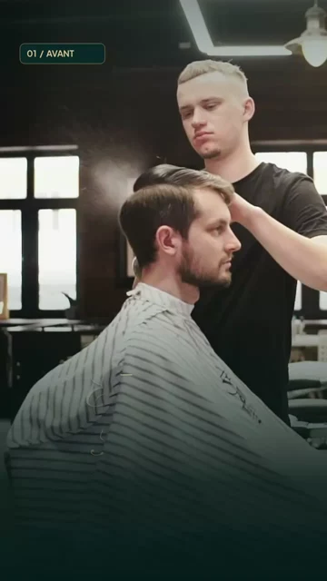
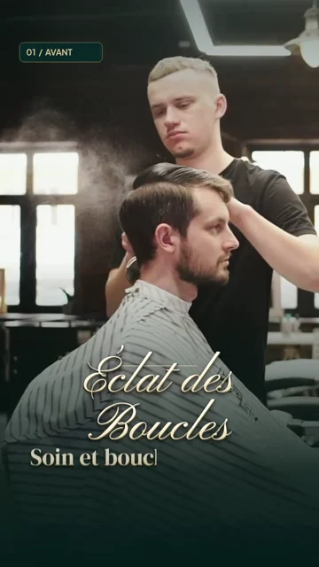
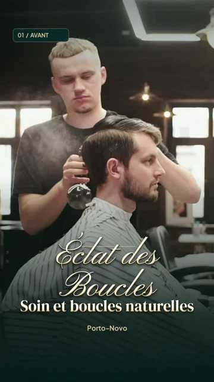

> **Document historique** : cette recette précède les deux remplacements musicaux ; sa liste de pistes ne décrit pas la rotation actuelle. Voir [la liste actuelle](07-bandes-son-afrobeat.md).

# T2 · Recette de livraison

**Signature coiffure · gabarit 1.0.0**
Le T2 fabrique un MP4 personnalisé à partir de la fiche et des quatre prises. Il ne se contente plus d’ouvrir une variante préencodée.

## 1. Référence publique auditée, sans modification

| Version T1 | Révision | Contrôle |
| :--- | :--- | :--- |
| [Silencieuse stable](https://github.com/j9028379-hue/vitrine-video-t1-pilot/releases/tag/t1-special-menu-template-v1.0.0-silent) | `cab2aa2a4a841341c9e84aeb08e243ea9baec0f4` | ZIP de la Release téléchargé et vérifié par SHA-256 ; validateur autonome **14/14**, y compris le MP4 et les images témoins. |
| [Successeur musical](https://github.com/j9028379-hue/vitrine-video-t1-pilot/releases/tag/t1-special-menu-music-v1.0.0) | `abe4812c98efe57abf00412808bd99338da5a843` | ZIP de la Release vérifié par SHA-256 ; validateur du sidecar **PASS** sur la base silencieuse : intégrité, quatre pistes approuvées, durée/format, absence de `573944`. |
| [Simulation publique A/B/C](https://github.com/j9028379-hue/vitrine-video-t1-pilot/blob/ad4ff15a76dcba7bd08b7e8f56052e842b3e794f/simulation/index.html) | `ad4ff15a76dcba7bd08b7e8f56052e842b3e794f` | Provenance conservée dans [`provenance-ecrans.json`](../ingenierie/provenance-ecrans.json). |

Le canonique T1 `config/T1_special_menu_template_v1_0_0.json` (`5a742abf…`) et le guide `capture-guide/consignes_T1.json` (`93a807f8…`) sont **identiques aux deux tags**. Le successeur ajoute une configuration et un manifeste musicaux, pas un nouveau canonique image. Le manifeste silencieux identifie le paquet ; le canonique T1 n’a pas les trois clés T2 sous ces noms. Les suites historiques T1 (51/98 annoncées par les Releases) ne sont pas comptées comme des tests rejoués ici. Aucun contenu restaurant, rush, tempo, titre musical ou résultat T1 n’est intégré au T2.

## 2. Métadonnées du plan T2

Canonique réellement lu par `rendu.py` (master muet) et `assets/t2-render.worker.mjs` (rendu fiche) : [`ingenierie/plan.json`](../ingenierie/plan.json).

| Clé ajoutée à la racine | Valeur | Sens |
| :--- | :--- | :--- |
| `template_id` | `T2` | Secteur coiffure. |
| `version` | `1.0.0` | Version du gabarit, différente de la v1.2 du catalogue. |
| `audio_profile` | `coiffure-afrobeat-amapiano` | Identifiant stable du profil d’ambiance, résolu par `profile_id` dans `afrobeat.json`. Aucun nom de fichier, ID de piste ou BPM imposé. |

Le commit d’identité `1069edd` ne contient que ces trois ajouts. Les validations, la liaison du catalogue et le montage dynamique sont des changements séparés. Le JSON n’intègre ni mécanisme OTA, ni téléchargement de gabarit, ni dépendance Cloudflare.

### Avant / après à entrées identiques

Deux rendus du même `rendu.py`, avec la même fixture T2 locale, quatre rushs, polices et encodeur, respectivement avec et sans les trois métadonnées. Le plan redevient strictement égal lorsqu’on retire ces clés. Les deux MP4 ont **exactement les mêmes octets** que le master silencieux de référence local : 9 060 752 octets, H.264, 720 × 1280, 30 i/s, 900 images, 30,00 s, aucune piste audio. SHA-256 des trois fichiers :

```text
64cde485d17af9e0e645b0c19526bb738e329bec0549ccfb324c43d3d0a8b76d
```

Les quatre rushs et les quatre MP4 musicaux validés ont eux aussi été contrôlés à l’octet. Le dépôt public v2 avait un ancien exemplaire du film ; cette comparaison isole l’ajout des métadonnées sur **le même cas à 1 500 FCFA**, sans confondre cette opération avec les changements intentionnels de l’habillage et la mise à niveau du catalogue. Aucune Release antérieure n’est remplacée. [Mesures et empreintes](../ingenierie/recette-identite-t2.json).

## 3. Rendu commercial : fiche → 12 écrans → MP4

- `fiche-t2.js`, `test.js`, `ecrans.js` et `simulation-t2.js` partagent la fiche de l’onglet ; un identifiant aléatoire seul circule dans l’URL. Les aperçus A/B/C ne valident jamais une prise.
- `build_ecrans.py` et `simulation-t2.html` sont les sources de génération. `prises-web.js` conserve quatre prises et leur chrono de lecture. Les fenêtres image restent **0–5 / 5–11 / 11–15,80 / 15,80–30 s**. Les sources de 6/7/7/7 s, recadrages, deux iris, raccord diagonal et dernière carte de 3,60 s restent en place.
- `t2-motion.mjs` peint le film et les textes dans chaque image. **Pinyon Script ivoire et DM Serif Display** avec ombre légère reprennent le style de la photo de référence, sans ses mots ni ses images. Nom, prestation, tarif facultatif, lieu, résultat et action/contact apparaissent aux moments pertinents. Le téléchargement n’est débloqué qu’après un encodage complet. `film.html` reste une démo historique distincte.
- Le catalogue v1.2 et la rotation restent séparés : **Alex Morgan → Harbor Lanterns → ARPMedia → Elijah_K** est l’ordre du catalogue, pas un ordre forcé des tirages. Le moteur recopie les paquets AAC du fond choisi. Les variantes ne contiennent aucune narration d’essai. Le lecteur, la relecture et le bouton de téléchargement ont la même URL Blob.
- L’atelier optionnel reprend l’image et, si souhaité, **le fond déjà choisi**, sans nouveau tirage. Il sait mixer une voix dans sa langue et peut lire un texte en français ou en anglais si les modèles sont installés. Baisse du fond de 13 dB sous la voix, remontée progressive, sans accélération. Le téléchargement du remix est le même MP4 que l’aperçu.

### Preuves tirées du MP4 téléchargé

Fiche fictive : **Éclat des Boucles** · **Soin et boucles naturelles** · **5 200 FCFA** · **Porto-Novo** · « Les boucles après le soin » · « Appeler le salon », avec un numéro fictif. Il ne s’agit pas d’un commerce réel ni d’une offre validée.

| Début sans titre | Apparition | Titre complet |
| :---: | :---: | :---: |
|  |  |  |

[Tarif à 3,00 s](t2/03-tarif.webp) · [Résultat à 17,30 s](t2/04-resultat.webp) · [Carton final à 27,80 s](t2/05-cta.webp). Les images proviennent du **fichier téléchargé**, pas d’une capture du lecteur web ni d’une maquette. Elles ont été réduites à 360 × 640 pour le rapport.

## 4. Recettes et limites

- Suites Python gabarit, média, mixage et identité : **35 PASS** (28 existants adaptés et rejoués, 7 contrôles d’identité et de livraison).
- [Manifest de livraison](../ingenierie/manifest-t2.json) : **83 empreintes** vérifiées, avec contrôles explicites des neuf médias conservés.
- [Parcours fiche et voix](../ingenierie/recette-t2-fiche.json) : douze états liés, nouveau MP4 H.264/900 images, 30,00 s, AAC 48 kHz stéréo ; même SHA pour aperçu et export. AAC **et PCM décodé** identiques au fond choisi avant narration. Après synthèse FR : AVC inchangé, fond maintenu, −16,75 LUFS-I et −3,92 dBTP, quatre intervalles parlés, ducking 13 dB. L’ASR local récupère correctement les phrases courantes du MP4 ; les noms propres sont transcrits phonétiquement et demandent une écoute humaine avant diffusion.
- [Prises importées sur un site statique sous un préfixe Pages](../ingenierie/recette-t2-import.json) : quatre fichiers locaux, contrôle de durée, aucun envoi de la fiche ou des rushs, géométrie/durée et piste AAC conformes.
- Recettes navigateur : **13 contrôles parcours**, **6 audio Web** et **7 atelier** (dont capture micro simulée, FR/EN et refus de la troncature). Navigation et audio documentés dans [`recette-parcours.json`](../ingenierie/recette-parcours.json) et [`recette-audio-web.json`](../ingenierie/recette-audio-web.json). Chrome/Chromium a été testé ; la caméra native et le microphone physiques, Safari/iOS et le déploiement sous charge ne constituent pas des résultats de cette recette.

Le rendu local d’un MP4 sans voix ne demande pas de serveur de calcul. L’ajout de la voix demande **le serveur de l’atelier** : ni GitHub Pages ni un commit ne l’hébergent. La voix, les essais privés et les originaux musicaux ne sont pas publiés avec le gabarit.
