# Les 12 écrans de Vitrine Vidéo Coiffure

Même fiche pour une coupe, des tresses, une couleur ou une barbe. Quatre prises, avec à chaque fois : une consigne, le temps pour filmer et une question après lecture. Les captures viennent de la simulation ; elle ne demande pas la caméra.

Pour essayer le parcours, la page interactive du dépôt est `ecrans.html`.

## Les questions de la fiche

1. Quel nom veux-tu montrer ?
2. Où travailles-tu ?
3. Quel travail veux-tu montrer ?
4. Quel est le prix ? (Tu peux laisser vide.)
5. Que veux-tu montrer à la fin ?
6. Que doit faire la personne après la vidéo ?

## Prise 1 — Toi au travail

| 01 · Consigne | 02 · Enregistrement | 03 · Après lecture |
| :---: | :---: | :---: |
| 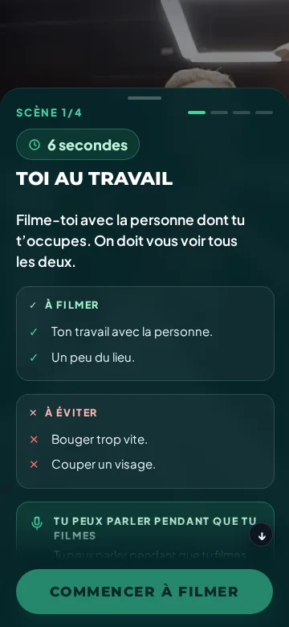 | 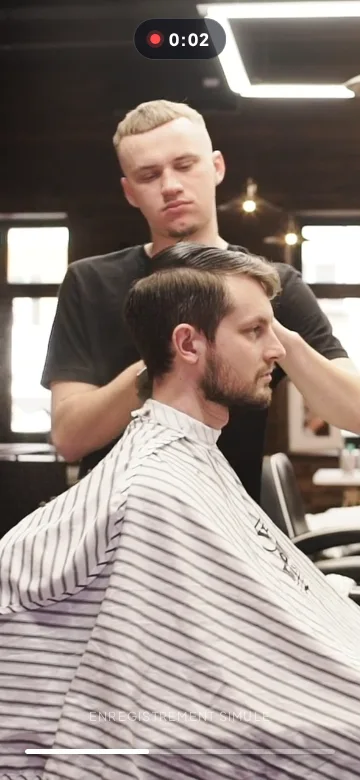 | 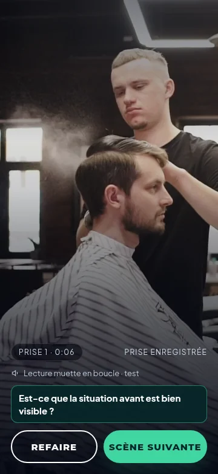 |

**Après lecture :** Est-ce qu’on vous voit bien tous les deux ?

## Prise 2 — Le geste

| 04 · Consigne | 05 · Enregistrement | 06 · Après lecture |
| :---: | :---: | :---: |
| 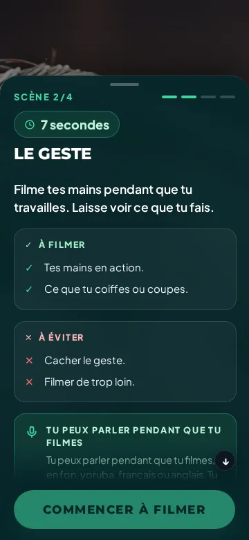 | 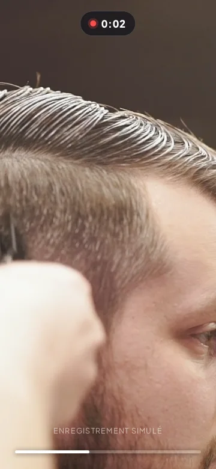 | 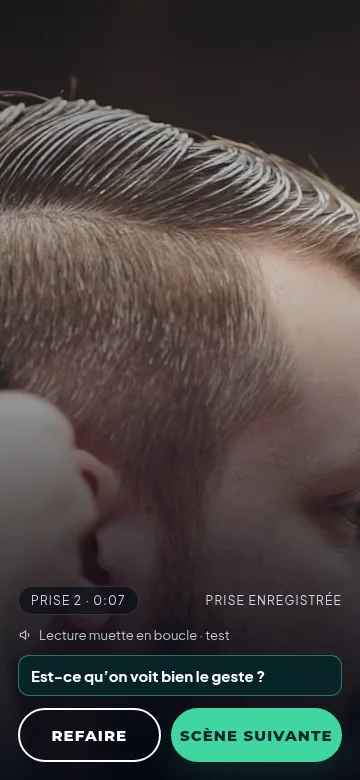 |

**Après lecture :** Est-ce qu’on voit bien ce que font tes mains ?

## Prise 3 — Le détail

| 07 · Consigne | 08 · Enregistrement | 09 · Après lecture |
| :---: | :---: | :---: |
| 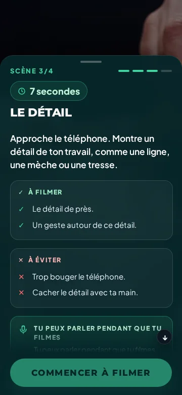 | 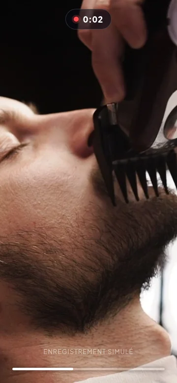 | 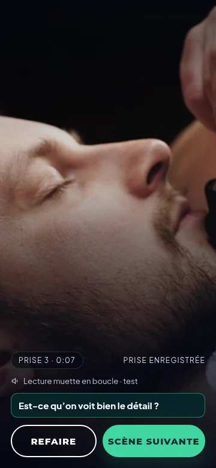 |

**Après lecture :** Est-ce qu’on voit bien le détail de près ?

## Prise 4 — Le résultat

| 10 · Consigne | 11 · Enregistrement | 12 · Après lecture |
| :---: | :---: | :---: |
| 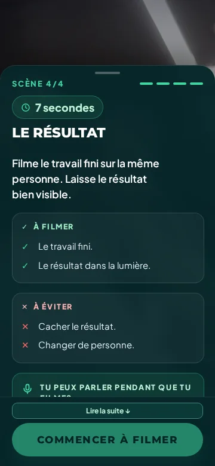 | 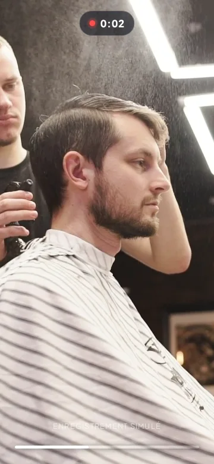 | 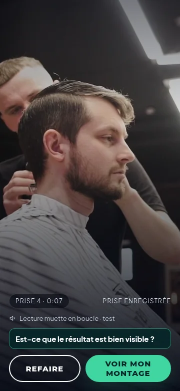 |

**Après lecture :** Est-ce qu’on voit bien le résultat sur la même personne ?

